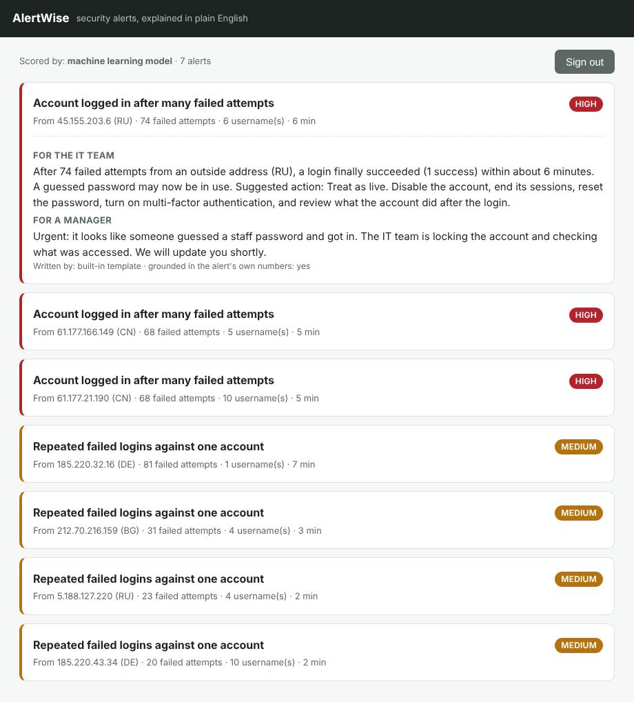
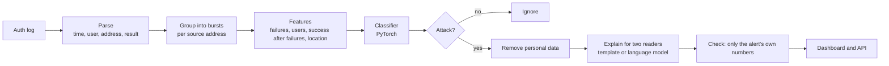
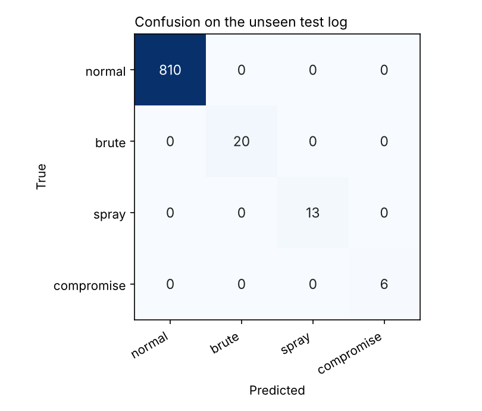

# AlertWise

**Spot attacks in server login logs, and explain each one in plain English for
two kinds of reader: the IT team and a non-technical manager.**

AlertWise reads an SSH authentication log, groups the activity by where it came
from, uses a small machine learning model to decide whether each group is an
attack, and then writes a short, clear explanation of every alert. Personal
data is removed before any text is sent to a language model, and every
explanation is checked so it can only use the alert's own numbers.



## Why this project

Security tools often raise alerts that only an expert can read. The aim here is
different: find the real problems, and say what happened in words anyone can
act on. The same alert is written twice, once for the IT team with the numbers
and the action to take, and once for a manager with what it means and how
urgent it is.

## How it works



The classes are: normal, brute force (many tries against one account), password
spray (one password against many accounts), and account compromise (a login
that succeeds after many failures, the serious case).

## Results

The model is trained on one simulated network and tested on a **different** one
it never saw (a different random seed). The test set has 849 activity bursts,
39 of them real attacks.

| | Attacks found | False alarms | Recall |
|---|---|---|---|
| **Machine learning model** | **39 / 39** | **0** | **1.00** |
| Readable rule baseline | 24 / 39 | 0 | 0.62 |

The baseline is a sensible set of fixed thresholds. It works on obvious
attacks, but misses smaller ones: on brute force alone its recall is 0.30,
because real attacks are not always large. The model learns where the line sits
and catches the borderline cases too.



**Checked on real data.** Run against a public sample of 2,000 lines from a real
SSH server (the LogHub OpenSSH log), the model flags 8 attacking addresses,
including the genuine attacker in that file (183.62.140.253, with 286 failed
logins). This sample has no labels, so it is a sanity check, not a score.

## Privacy and trust

Two things make the explanations safe to rely on:

- **Personal data is removed first.** User names and IP addresses are personal
  data under GDPR. Before any text goes to a language model, they are replaced
  with tokens like `USER_1` and `ADDR_1`. The real values are put back only in
  the note shown to staff inside the company. See `aw/redact.py`.
- **Explanations cannot invent numbers.** Every number in an explanation is
  checked against the alert's own facts. If a language model adds a figure that
  is not in the alert, the text is rejected and a plain template is used
  instead. See `check_grounded` in `aw/explain.py`.

The language model step is optional. By default AlertWise writes explanations
from a built-in template, so it runs with no model and no internet. You can
point it at any OpenAI-compatible endpoint (for example a local Ollama server)
with environment variables, and the privacy and number checks still apply.

## Sign-in

The dashboard and API need a login. Passwords are never stored in plain text:
they are kept as a salted PBKDF2-HMAC-SHA256 hash, checked in constant time. A
successful login returns a signed token (HMAC-SHA256) that carries an expiry,
so no session store is needed. See `aw/auth.py`.

## Run it

```bash
pip install -r requirements.txt
make data      # create the simulated logs with ground truth
make detect    # train the model, test it, run on the real sample
make test      # 19 tests
make serve     # dashboard at http://127.0.0.1:8000  (sign in: analyst / alertwise)
```

## Project layout

```
aw/
  parse.py      read OpenSSH auth logs into events
  geo.py        a small stand-in for a GeoIP lookup
  sim.py        simulated network with hidden attacks and exact ground truth
  detect.py     group events into bursts, build features, rule baseline
  model.py      the PyTorch classifier
  redact.py     remove personal data before the language model
  explain.py    write both explanations, check they are grounded
  llm.py        optional language-model backend (OpenAI-compatible)
  auth.py       password hashing and signed tokens
  api.py        FastAPI app
  pipeline.py   raw log in, explained alerts out
web/            the dashboard page
scripts/        make_data, run_detect, make_demo
tests/          19 tests
data/real/      a public LogHub OpenSSH sample for the real-data check
```

## Honest limits

- The training data is simulated, so the headline scores are higher than real
  traffic would give. The real-data check matters more than the test score.
- The simulated attacks cover four common patterns. Real networks see many
  more, and a production version would learn from labelled real logs.
- The tracker works on SSH auth logs. Web and Windows logs would each need their
  own parser and features, which the design allows for.
- The language model step needs an endpoint you provide. Nothing is sent
  anywhere by default.

Licence: MIT. Author: Jasper Chinedu Nwangere.
